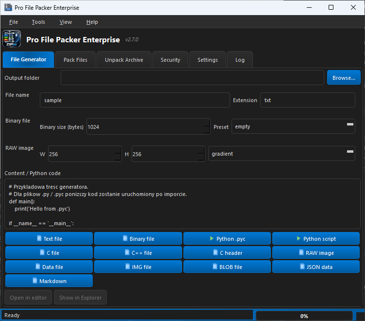
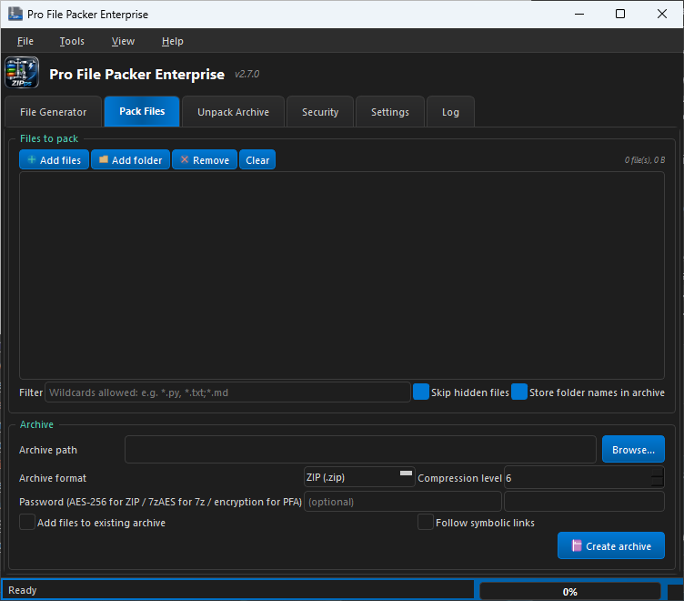
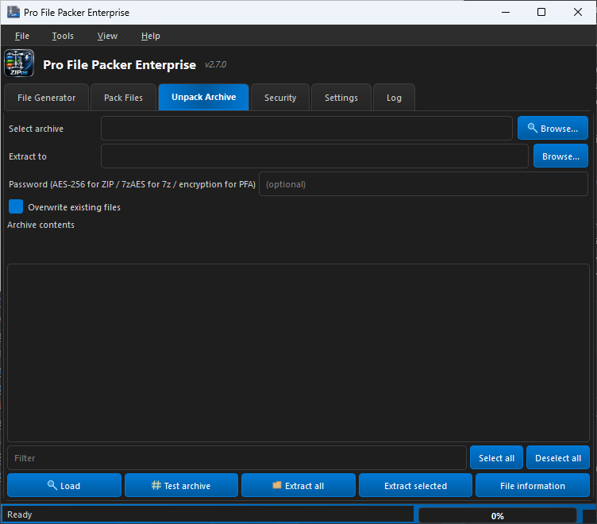
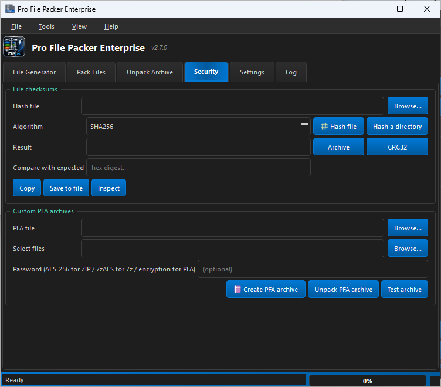
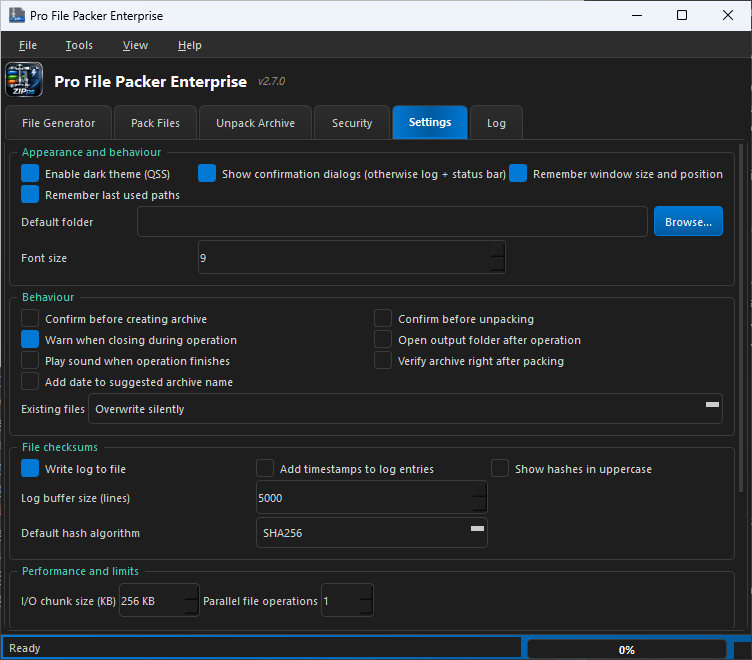
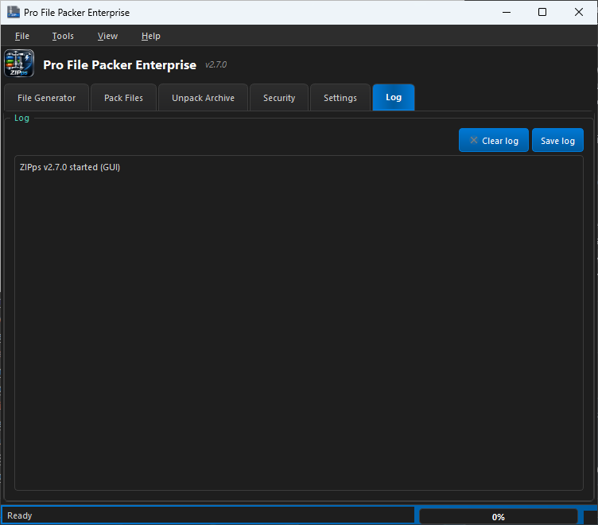
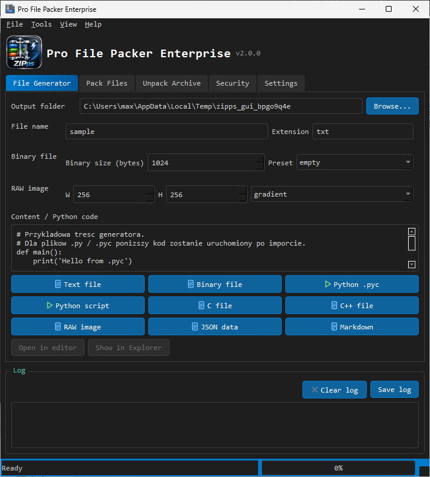

<div align="center">


# Pro File Packer Enterprise

**ZIPps — generate, pack, encrypt and verify files on Windows**

One app for file generation, archive packing/unpacking, AES-256 encryption and 11 checksum algorithms — with both a GUI and a CLI.

[](#release-notes)
[](#system-requirements)
[](#system-requirements)
[](#getting-started)
[](#command-line-reference)
[](#system-requirements)
[](#supported-languages)
[](#legal-notice)
[](https://github.com/polsoft-it)

<table align="center">
  <tr>
    <td align="center"><br /><sub>File generator</sub></td>
    <td align="center"><br /><sub>Pack</sub></td>
    <td align="center"><br /><sub>Unpack</sub></td>
  </tr>
  <tr>
    <td align="center"><br /><sub>Security</sub></td>
    <td align="center"><br /><sub>Settings</sub></td>
    <td align="center"><br /><sub>Log</sub></td>
  </tr>
</table>

</div>

---

## Short description

> Generate, pack, encrypt and verify files — ZIP, TAR, 7z, AES-256 and checksums in one app.

<sub>Microsoft Store "Short description" field — 91 characters.</sub>

## Overview

**Pro File Packer Enterprise** (product name **ZIPps**) is a Windows desktop application that bundles the everyday file tasks of a developer or power user into a single, fast, offline tool. Create sample and test files in a dozen formats, pack or unpack archives, verify their integrity, and compute or compare cryptographic checksums — all without a browser, a cloud service, or an internet connection.

The application ships as a self-contained executable (`ZIPps.exe`). It runs from a single file with no installer scripts and **no separate Python installation required**.

It offers a modern graphical interface for everyday use and a full command-line interface for scripting and automation — both expose the same engine.

## Highlights

| | Capability | Pro File Packer Enterprise |
|---|---|---|
| 🗜️ | **Archive formats** | ZIP, TAR (+ GZ, BZ2, XZ, ZST, LZ4, BR), 7z, single-stream GZ/BZ2/XZ/ZST/LZ4/BR, AR, ISO/RAR (verify), and the native **PFA** format |
| 🔐 | **Encryption** | AES-256 for ZIP plus native encryption for PFA archives |
| 🛡️ | **Security** | Zip Slip path-traversal protection on extraction, integrity testing, safe-join path validation |
| 🧪 | **Checksums** | 11 algorithms — MD5, SHA-1, SHA-2 (224/256/384/512), SHA-3 (256/512), BLAKE2b, BLAKE2s, CRC32 — for files and whole directories |
| 🏭 | **File generator** | Text, binary, `.pyc`, Python, C/C++/H, RAW images, JSON, Markdown, `.dat`, `.img`, `.blob` |
| 🔍 | **Inspection** | Magic-byte detection, `.pyc` disassembly, text preview, sizes and timestamps |
| 🖥️ | **Two interfaces** | Full GUI and a scriptable CLI; the CLI works even where the GUI stack is unavailable |
| 🌐 | **Localization** | English and Polish UI, switchable on the fly |
| 🎨 | **Experience** | Clean light/dark theme, keyboard shortcuts, drag & drop |

## Screenshots

<div align="center">

<p>
  
  
</p>
<p>
  
</p>

</div>

## System requirements

| | Requirement |
|---|---|
| **Operating system** | Windows 10 (version 1809 or later) or Windows 11 |
| **Architecture** | x64 |
| **Processor** | 1 GHz or faster |
| **Memory** | 2 GB RAM minimum, 4 GB recommended |
| **Hard disk space** | ~250 MB available space |
| **Display** | 1280 × 720 or higher |
| **Runtime** | None — the required runtime is bundled in `ZIPps.exe` |
| **Connectivity** | Not required — the app works fully offline |

> Additional archive formats (7z, RAR, ISO) are available when the corresponding optional Python packages are present in the environment; the Windows build bundles them where applicable.

## Getting started

### Run the application

1. Download `ZIPps.exe`.
2. Double-click it to open the graphical interface.
3. Drag files or folders onto the window, or use the **Generate**, **Pack**, **Unpack** and **Security** tabs.

### Command line

Open PowerShell in the folder that contains `ZIPps.exe` and run `ZIPps.exe --help` to see all commands.

```powershell
ZIPps.exe                                  # launch the graphical interface

ZIPps.exe pack . -o backup.zip -f zip --password "secret" --level 9
ZIPps.exe unpack backup.zip -d restored\
ZIPps.exe list backup.zip
ZIPps.exe hash image.iso --algo sha256 --compare 9f86d08188...
ZIPps.exe info module.pyc
ZIPps.exe test backup.zip
ZIPps.exe gen pyc --name module
```

## Command-line reference

| Command | Description |
|---|---|
| `pack` | Pack files and folders into an archive (optionally encrypted and appending to an existing ZIP) |
| `unpack` | Extract an archive; format is detected automatically |
| `list` | List archive contents as text or JSON |
| `hash` | Compute a checksum, optionally comparing it with an expected value |
| `info` | Show file information: size, timestamps, magic bytes and `.pyc` details |
| `test` | Verify archive integrity |
| `gen` | Generate a sample file of a chosen kind |
| `gui` | Launch the graphical interface |
| `settings` | Print the path of the settings file |

### Common `pack` options

| Option | Description |
|---|---|
| `-o, --output` | Output archive path (required) |
| `-f, --format` | Force a format (`zip`, `tar`, `targz`, `tarbz2`, `tarxz`, `tarzst`, `tarlz4`, `tarbr`, `gz`, `bz2`, `xz`, `zst`, `lz4`, `br`, `ar`, `7z`, `pfa`) |
| `--password` | Password for ZIP AES-256 or PFA encryption |
| `--level` | Compression level, `0`–`9` (default `6`) |
| `--filter` | Include only matching patterns, e.g. `"*.py;*.txt"` |
| `--flat` | Store files without their folder structure |
| `--include-hidden` | Include hidden files |
| `--append` | Append to an existing ZIP archive |

## Supported formats

**Create and extract**

| Category | Formats |
|---|---|
| Archives | ZIP, TAR, 7z, AR |
| Compressed TAR | TAR.GZ (`.tgz`), TAR.BZ2 (`.tbz2`), TAR.XZ (`.txz`), TAR.ZST, TAR.LZ4, TAR.BR |
| Single-stream | GZ, BZ2, XZ, ZST, LZ4, BR |
| Native | PFA (magic `PFA1` / `PFA2`), with optional encryption |

**Verify / list only:** RAR, ISO.

## Checksum algorithms

`md5` · `sha1` · `sha224` · `sha256` · `sha384` · `sha512` · `sha3_256` · `sha3_512` · `blake2b` · `blake2s` · `crc32`

Checksums can be computed for a single file or recursively for a directory, and compared against an expected value (exit code `3` signals a mismatch, which makes the CLI easy to use in scripts).

## File generator

Create ready-to-use test files in one step:

| Kind | Output |
|---|---|
| `text` | Plain text file |
| `bin`, `dat`, `blob`, `img` | Binary file of any size |
| `pyc`, `py` | Python source and compiled bytecode |
| `c`, `cpp`, `h` | C / C++ source and header |
| `raw` | RAW image (gradient or pattern) |
| `json`, `md` | Structured JSON and Markdown documents |

## Security

- **Zip Slip protection** — every extracted path is validated so that archive entries can never escape the destination folder.
- **Safe path joining** — all relative paths are normalized and confined to the target directory.
- **Integrity testing** — `test` verifies the CRC and structure of an archive before you rely on it.
- **Local encryption** — ZIP AES-256 and native PFA encryption are applied on your machine; nothing is uploaded.

## Supported languages

| Language | UI | Documentation |
|---|---|---|
| English | ✅ | ✅ |
| Polski | ✅ | ✅ |

## Legal notice

Copyright © Sebastian Januchowski. Published by **polsoft.ITS™**. The application is proprietary; `ZIPps.exe` and its bundled components may not be redistributed without permission.

---

## Store listing metadata

*Ready-to-use metadata for the Microsoft Store / Partner Center listing.*

| Field | Value |
|---|---|
| **Product name** | Pro File Packer Enterprise |
| **Internal name** | ZIPps |
| **Executable** | `ZIPps.exe` |
| **Version** | 2.7.0.0 |
| **Publisher display name** | polsoft.ITS™ |
| **Category** | Developer tools · Utilities & tools |
| **Supported languages** | English (United States), Polski (Polska) |
| **Age rating** | 3+ (no objectionable content) |
| **Privacy policy** | Not applicable — the app collects no data and works fully offline |
| **Support contact** | polsoft.its@mail.com |
| **Support page** | https://github.com/polsoft-it |

### Short description

> Generate, pack, encrypt and verify files — ZIP, TAR, 7z, AES-256 and checksums in one app.

### Full description

Pro File Packer Enterprise is an all-in-one Windows tool for working with files and archives.

**Generate.** Create test and sample files in a dozen formats: plain text, binary of any size, Python scripts and compiled `.pyc`, C/C++ sources, RAW images, JSON and Markdown.

**Pack and unpack.** Work with ZIP, TAR and its compressed variants (GZ, BZ2, XZ, ZST, LZ4, BR), single-stream archives, 7z, AR, and the native PFA format. Extract RAR and ISO archives too.

**Protect.** Encrypt ZIP archives with AES-256 or use the built-in PFA encryption. Zip Slip path-traversal protection keeps extraction safe.

**Verify.** Compute any of 11 checksum algorithms — MD5, SHA-1, SHA-2, SHA-3, BLAKE2 and CRC32 — for single files or entire directories, and compare against an expected value.

**Inspect.** Read magic bytes, disassemble `.pyc` files, preview text, and check sizes and timestamps.

Use the modern graphical interface for everyday tasks, or drive the same engine from the command line for scripting and automation. The app works completely offline and requires no separate runtime.

### Product features (Store features list)

- Generate test files: text, binary, `.pyc`, Python, C/C++, RAW images, JSON, Markdown
- Pack and unpack ZIP, TAR, GZ/BZ2/XZ/ZST/LZ4/BR, 7z and the native PFA format
- AES-256 encryption for ZIP archives plus native PFA encryption
- Zip Slip path-traversal protection and archive integrity verification
- 11 checksum algorithms (MD5, SHA-1, SHA-2, SHA-3, BLAKE2, CRC32) for files and folders
- File inspection: magic bytes, `.pyc` disassembly and text preview
- Full GUI **and** scriptable CLI in one self-contained executable
- English and Polish interface, switchable on the fly
- Works fully offline with no data collection

### What's new in 2.7.0

- Modular engine (`zipps_pkg`) with a thin `ZIPps.py` entry point
- Additional compression formats: ZST, LZ4, BR (TAR variants and single-stream)
- 7z, AR, ISO and RAR listing/extraction support
- Expanded archive inspection and integrity testing

---

## Support and feedback

| | |
|---|---|
| **Email** | [polsoft.its@mail.com](mailto:polsoft.its@mail.com) |
| **GitHub** | [github.com/polsoft-it](https://github.com/polsoft-it) |

When reporting an issue, please include the app version, your Windows version and the steps to reproduce the problem.

---

<div align="center">

**Pro File Packer Enterprise** · Version 2.7.0 · One app · Everything on board

---

[](#legal-notice)
[](https://github.com/polsoft-it)
[](mailto:polsoft.its@mail.com)
[](https://github.com/polsoft-it)

</div>
