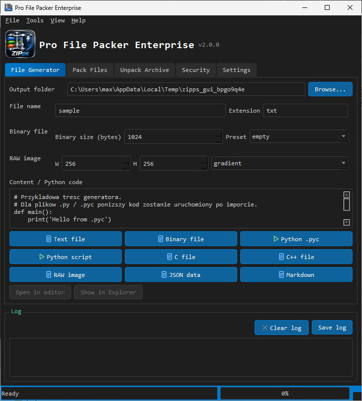

<div align="center">

<p align="center">
  <a href="readme.en.md">🇬🇧 English</a> ·
  <a href="readme.pl.md">🇵🇱 Polski</a>
</p>

<h1>📦 ZIPps — Pro File Packer Enterprise</h1>

**Generator plików · Pakowanie · Szyfrowanie · Sumy kontrolne — w jednym pliku Pythona**

`Wersja 2.0.0` · `Python 3` · `PySide6` · `GUI + CLI`



</div>

---

## ✨ Co wyróżnia ZIPps na tle innych narzędzi?

| Funkcja | ZIPps | Typowe narzędzia |
|---|---|---|
| 🗜️ Formaty ZIP / TAR / GZ / BZ2 / XZ **+ własny format PFA** | ✅ | zwykle tylko ZIP/TAR |
| 🔐 ZIP z **AES-256** oraz własne szyfrowanie PFA | ✅ | często brak lub płatne |
| 🛡️ Ochrona przed atakiem **Zip Slip** przy rozpakowywaniu | ✅ | rzadko spotykana |
| 🧪 **11 algorytmów** sum kontrolnych (SHA-2, SHA-3, BLAKE2, CRC32…) | ✅ | zwykle 1–2 |
| 🏭 **Generator plików**: tekst, binarne, `.pyc`, C/C++, RAW, JSON, Markdown | ✅ | brak |
| 🔍 Inspekcja plików: *magic bytes*, dekompilacja `.pyc`, podgląd tekstu | ✅ | brak |
| 🖥️ **GUI i CLI w jednym pliku** — CLI działa nawet bez Qt | ✅ | osobne projekty |
| 🌐 Interfejs **PL / EN** przełączany w locie | ✅ | zwykle jeden język |
| 🎨 Motyw ciemny QSS, skróty klawiszowe, drag & drop | ✅ | częściowo |

## 🚀 Szybki start

```powershell
pip install PySide6
python ZIPps.py          # GUI
python ZIPps.py --help   # CLI
```

## 🧰 Archiwa i bezpieczeństwo

- **Formaty:** ZIP, TAR, TAR.GZ, TAR.BZ2, TAR.XZ oraz autorski **PFA** (magia `PFA1`/`PFA2`)
- **Szyfrowanie:** AES-256 dla ZIP, wbudowane szyfrowanie dla PFA
- **Sumy kontrolne:** md5, sha1, sha224/256/384/512, sha3_256/512, blake2b, blake2s, crc32 — także dla całych katalogów, z porównaniem z oczekiwaną wartością
- **Bezpieczeństwo:** walidacja ścieżek (Zip Slip), test integralności archiwów, rozmiary i daty plików

## 🏭 Generator plików

Twórz pliki testowe jednym kliknięciem: tekstowe, binarne (dowolny rozmiar), skrypty Python i skompilowane `.pyc`, pliki C/C++, obrazy RAW (gradient/wzory), dane JSON i Markdown.

## ⌨️ CLI

```text
pack | unpack | list | hash | info | test | gen | gui | settings
```

Przykłady:

```powershell
python ZIPps.py pack . -f zip --password "tajne"
python ZIPps.py hash plik.iso --compare <sha256>
python ZIPps.py gen pyc --name modul
```

## 🧪 Testy

```powershell
python -m unittest discover -s tests -v
```

## 🗂️ Dokumentacja

- [Opis kompilatora/narzędzia (EN, ≤350 znaków)](opis.txt)
- Zrzuty ekranu: `screenshot.png`, `app.png`, `file2.png`

---

<div align="center">

**ZIPps** · Wersja 2.0.0 · Jeden plik · Wszystko na miejscu

---

[]()
[]()
[](mailto:polsoft.its@mail.com)
[](https://github.com/polsoft-it)

</div>
