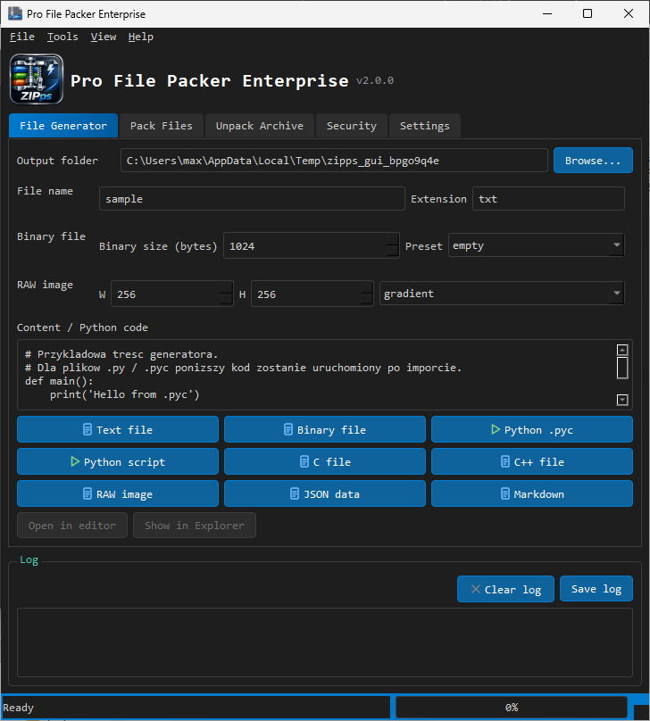

<div align="center">

<p align="center">
  <a href="readme.en.md">🇬🇧 English</a> ·
  <a href="readme.pl.md">🇵🇱 Polski</a>
</p>

<h1>📦 ZIPps — Pro File Packer Enterprise</h1>

**File Generator · Packing · Encryption · Checksums — in a single Python file**

`Version 2.0.0` · `Python 3` · `PySide6` · `GUI + CLI`



</div>

---

## ✨ What sets ZIPps apart from other tools?

| Feature | ZIPps | Typical tools |
|---|---|---|
| 🗜️ ZIP / TAR / GZ / BZ2 / XZ formats **+ custom PFA format** | ✅ | usually ZIP/TAR only |
| 🔐 ZIP with **AES-256** plus native PFA encryption | ✅ | often missing or paid |
| 🛡️ Protection against **Zip Slip** attacks on extraction | ✅ | rarely seen |
| 🧪 **11 checksum algorithms** (SHA-2, SHA-3, BLAKE2, CRC32…) | ✅ | usually 1–2 |
| 🏭 **File generator**: text, binary, `.pyc`, C/C++, RAW, JSON, Markdown | ✅ | none |
| 🔍 File inspection: *magic bytes*, `.pyc` disassembly, text preview | ✅ | none |
| 🖥️ **GUI and CLI in one file** — CLI works even without Qt | ✅ | separate projects |
| 🌐 **PL / EN** UI switched on the fly | ✅ | usually one language |
| 🎨 QSS dark theme, keyboard shortcuts, drag & drop | ✅ | partial |

## 🚀 Quick start

```powershell
pip install PySide6
python ZIPps.py          # GUI
python ZIPps.py --help   # CLI
```

## 🧰 Archives & security

- **Formats:** ZIP, TAR, TAR.GZ, TAR.BZ2, TAR.XZ plus the custom **PFA** format (magic `PFA1`/`PFA2`)
- **Encryption:** AES-256 for ZIP, built-in encryption for PFA
- **Checksums:** md5, sha1, sha224/256/384/512, sha3_256/512, blake2b, blake2s, crc32 — also for whole directories, with comparison against an expected value
- **Security:** path validation (Zip Slip), archive integrity testing, file sizes and timestamps

## 🏭 File generator

Create test files with a single click: text, binary (any size), Python scripts and compiled `.pyc`, C/C++ sources, RAW images (gradients/patterns), JSON and Markdown data.

## ⌨️ CLI

```text
pack | unpack | list | hash | info | test | gen | gui | settings
```

Examples:

```powershell
python ZIPps.py pack . -f zip --password "secret"
python ZIPps.py hash file.iso --compare <sha256>
python ZIPps.py gen pyc --name module
```

## 🧪 Tests

```powershell
python -m unittest discover -s tests -v
```

## 🗂️ Documentation

- [Tool description (EN, ≤350 characters)](opis.txt)
- Screenshots: `docs/screenshot.png`, `docs/app.png`, `docs/file1.png`, `docs/file2.png`

---

<div align="center">

**ZIPps** · Version 2.0.0 · One file · Everything on board

---

[]()
[]()
[](mailto:polsoft.its@mail.com)
[](https://github.com/polsoft-it)

</div>
